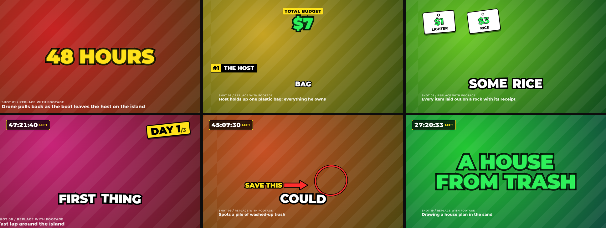

<h1 align="center">🎬 beast-skill</h1>

<p align="center">
  <b>MrBeast's internal production playbook => Claude skills</b><br>
</p>

<p align="center">
  <a href="https://github.com/hjunhuh/beast-skill/stargazers"></a>
  <a href="https://github.com/hjunhuh/beast-skill/actions/workflows/ci.yml"></a>
  <a href="https://github.com/hjunhuh/beast-skill/commits/main"></a>
  
  
  
  
</p>

<p align="center">
  <a href="#install">Install</a> |
  <a href="#three-skills">Skills</a> |
  <a href="#beast-remotion-render-the-edit">beast-remotion</a> |
  <a href="#deslop-kill-the-ai-voice">deslop</a>
</p>

<p align="center">
  
  <br><sub>The template's 88-second demo plan, rendered as is. Every shot is a placeholder that names the footage it stands for.</sub>
</p>

---

In one MrBeast video, **21 million of the 60 million people who clicked were gone within the first minute.** His playbook calls that *above average*.

In 2024 the onboarding document MrBeast wrote for new hires at his production company became public. It explains how the most-subscribed channel on YouTube plans, structures and edits every video: packaging first, an obsessive first minute, re-engagements at minutes 3 and 6, a back half that never signals the end, and an ending that cuts the moment the payoff lands.

This repo turns that playbook into three Claude skills that plan the video, render the edit and clean up the words around it.

## Install

**All three skills as a Claude Code plugin:**

```text
/plugin marketplace add hjunhuh/beast-skill
/plugin install beast-skill@beast-skill
```

**One skill at a time** (personal skills folder):

```bash
git clone https://github.com/hjunhuh/beast-skill
cp -r beast-skill/skills/beast-remotion ~/.claude/skills/   # or beast-skill, deslop
```

## Three skills

| Skill | What it does | Try saying |
|---|---|---|
| [**beast-skill**](skills/beast-skill/SKILL.md) | Plans and diagnoses long-form videos with the playbook: titles and thumbnails first, a minute-by-minute map, editor briefs, retention diagnosis, sponsor integration, shoot logistics | "48 hours on a deserted island with $10, 15 minutes. Titles, thumbnail, structure and an editor brief." |
| [**beast-remotion**](skills/beast-remotion/SKILL.md) | A working Remotion + TypeScript project that renders that plan as a MrBeast-style edit, with a checker that fails the plan when the structure is wrong | "Turn this section map into a Remotion edit with captions and SFX, classic style." |
| [**deslop**](skills/deslop/SKILL.md) | Finds and rewrites chatbot tells in English and Korean, with a zero-dependency TypeScript checker | "Deslop this README before I post it." |

## beast-skill: plan the video

The playbook's structure, built on MrBeast's average length of 13 minutes 37 seconds:

```
0:00      1:00               3:00                 6:00                          END
 |  HOOK   |  CRAZY            |  RE-ENGAGE #1      |  RE-ENGAGE #2               |
 |  match  |  PROGRESSION      |  simple, exciting, |  back half: long            |  ABRUPT
 |  the    |  show, don't tell |  fast scene        |  explanations live here,    |  ENDING
 |  thumb  |                   |  changes           |  never signal the end       |
```

Not making a 13-minute video? It scales: re-engagements land at length x 0.23 and length x 0.46.

| Your length | Re-engagement 1 | Re-engagement 2 |
|---|---|---|
| 8 min | ~1:50 | ~3:41 |
| 10 min | ~2:18 | ~4:36 |
| 15 min | ~3:27 | ~6:54 |
| 20 min | ~4:36 | ~9:12 |

Six modes, picked from what you bring: packaging-first planning, a minute-by-minute map, edit notes, retention diagnosis, sponsor integration and production operations. Every note comes with a timecode and the metric it protects (CTR, AVD or AVP), and the skill marks which parts come from the playbook and which parts it scaled.

## beast-remotion: render the edit

`skills/beast-remotion/template` is a complete Remotion project. One typed **edit plan** drives the whole video:

```ts
const plan: EditPlan = {
  title: "48 Hours On A Deserted Island With $10",
  preset: "classic",                       // or "modern" (2024+ pacing)
  fps: 30, width: 1920, height: 1080,
  thumbnailPromise: ["island", "plastic bag", "$10", "trash house"],
  clips: [{ source: { kind: "video", src: "footage/boat.mp4" }, duration: 3, promise: ["island"] }, /* ... */],
  captions,                                // word-level timestamps
  overlays: [{ type: "counter", from: 0, to: 10, prefix: "$", label: "Total budget", at: 3.3, duration: 2.1 }],
  effects: [{ type: "punch", at: 0.1, duration: 0.6 }],
  sfx: [{ at: 0.15, name: "boom" }],
  markers: [{ at: 22.6, kind: "reengage-1" }, { at: 86, kind: "payoff" }],
};
```

```bash
cp -r skills/beast-remotion/template my-video && cd my-video && npm install
npm run check:demo                         # test a plan against the playbook
npm run dev                                # Remotion Studio, with a retention guide bar
npm run render:demo                        # out/demo.mp4
```

<p align="center">
  
</p>

**What's in the box**

| Piece | Details |
|---|---|
| Word-pop captions | 2-word chunks (classic) or keywords only (modern). Money turns green, numbers and keywords yellow, danger words red. Captions step aside for big statements |
| Camera | Punch zooms, decaying shake, slow push, tighter "second angle" crops, freeze frames |
| Graphics | Big text that slams in, money counters, a challenge timer that goes red in the last 10%, day stamps, stair-stepping price tags, circle and arrow callouts, elimination stamps, name tags, white flashes |
| Sound | Eight SFX (whoosh, pop, ding, boom, cash, riser, tick, buzzer) synthesized from math by `npm run assets`, so there is nothing to license. Music ducks under speech automatically |
| Retention checker | Fails a plan whose thumbnail elements don't appear before the hook ends or that has no re-engagements or payoff. Warns on late re-engagements, long shots, pacing, end signals, dead air and subscribe asks after the payoff |
| Placeholders | Plan the whole video before you shoot. Placeholders render as a moving storyboard |

The checker on the demo plan:

```text
PASS  [promise] Thumbnail element "$10" appears before 0:14.0.
PASS  [reengage] re-engagement 1 at 0:22.6 (target 0:22.0).
PASS  [reengage] re-engagement 2 at 0:44.8 (target 0:44.0).
PASS  [pacing] 25 cuts/min before re-engagement 1 (classic range 24 to 45).
PASS  [ending] Ends 2.1 s after the payoff.
```

**Two presets.** Tubefilter counted 38 cuts in one minute of a 2023 MrBeast video and 23 in a 2024 one, after he said he had slowed down and focused on story. `classic` reproduces the older retention style; `modern` follows the newer pacing and is the default for new uploads.

Remotion is free for individuals, non-profits and companies with up to 3 employees; larger companies need a [Remotion company license](https://remotion.dev/license).

## deslop: kill the AI voice

Your video is MrBeast-paced. Your description, pinned comment and README still read like a chatbot wrote them. deslop fixes that.

<!-- slop-check-ignore-start -->

> **Before:** In today's fast-paced world, video editing isn't just a skill — it's a superpower. Let's dive in! Moreover, mastering retention is crucial, highlighting the pivotal role of the first minute. I hope this helps!

<!-- slop-check-ignore-end -->

> **After:** Most viewers decide in the first minute whether to keep watching, so that is where editing effort pays off first.

```bash
node skills/deslop/scripts/slop-check.ts draft.md          # Node 22.18+, no install
node skills/deslop/scripts/slop-check.ts --max-density 3 README.md   # exit 1 if it reads like a bot
```

It knows 40+ English and Korean patterns: em dashes, "it's not X, it's Y" reveals, bold-label bullets, delve and tapestry vocabulary, chatbot openers and sign-offs, vague attributions, plus Korean translationese ("~에 있어서", "~를 통해") and stock closers ("도움이 되셨길 바랍니다"). It skips code blocks, and **this README passes it in CI**.

deslop builds on Wikipedia's *Signs of AI writing* guide, [blader/humanizer](https://github.com/blader/humanizer) and [hardikpandya/stop-slop](https://github.com/hardikpandya/stop-slop), restated and extended with Korean patterns.

## Sources

- *How to Succeed in MrBeast Production* (36 pages, written by Jimmy Donaldson). Made public in August and September 2024. According to Passionfruit, two former MrBeast producers confirmed its authenticity.
- Change in editing pace: Donaldson's public statement in March 2024, reported by The Washington Post.
